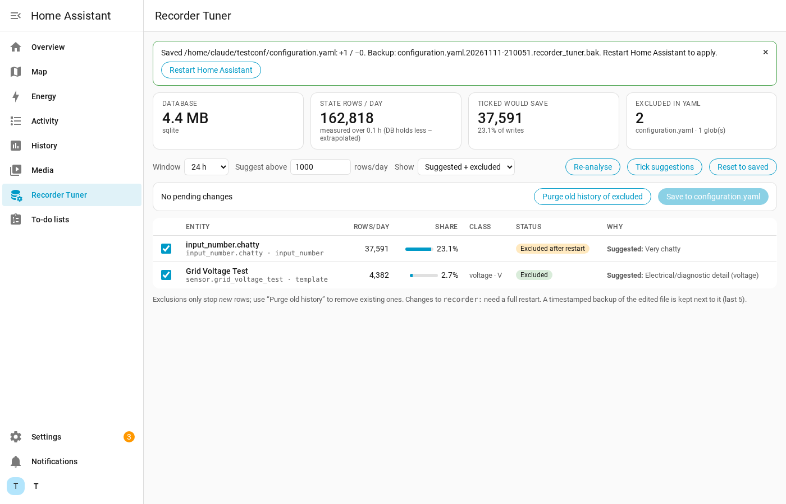

# Recorder Tuner for Home Assistant

Find the entities that are bloating your recorder database, tick the ones you don't need history for, and write the exclusions to `configuration.yaml`, all from a sidebar page.

## What it does

- **Measures** how many state rows each entity wrote over a window you choose (6 h – 7 days). It runs one `GROUP BY` query against the recorder database (SQLite, MariaDB or PostgreSQL).
- **Suggests** exclusions using a rows/day threshold you set, with a reason for each:
  - Ticked by default: electrical detail (voltage, current, power factor, apparent/reactive power), signal strength, sound level, and diagnostic noise (packet counters, kernel pressure, load averages, raw memory figures, throughput, uptime). Also anything 5× over the threshold.
  - Never suggested 🔒: anything used by the **Energy dashboard**, meter/total sensors (`state_class: total`/`total_increasing`, energy/gas/water/monetary), and person/device_tracker/zone/lock/alarm entities.
  - Not ticked by default: real power (W) and automations/scripts. You can still tick them yourself.
- **Domains tab**: rows/day and share per domain, with tick boxes that write to `recorder: exclude: domains:`. Domains that contain Energy dashboard entities are locked, and the big ones (sensor, binary_sensor, light…) carry a warning. Domain status shows *Recorded*, *Excluded*, *Excluded after restart* or *Partly excluded (n of m)* when your globs or entity rules cover some of it.
- **Writes** your entity ticks to `recorder: exclude: entities:`, and unticking removes an entity from that list. It only re-emits the `recorder:` block, so the rest of the file stays byte-for-byte identical. Comments, quotes and `!secret` are kept, and `recorder: !include recorder.yaml` is followed.
- **Protects your config**: it writes a timestamped backup first (the last 5 are kept) and runs Home Assistant's config check afterwards. If the edit introduced any new errors, the file is rolled back automatically.
- **Cleans up**: **Restart & purge** restarts HA, then (once it's back up) runs `recorder.purge_entities` for every entity that is no longer recorded, whether it's excluded by entity, domain or one of your own globs, followed by `recorder.purge` with `repack: true`, and posts a notification. The repack (SQLite `VACUUM`) is what actually shrinks the file; a purge without it only frees space inside the file. **Purge now** does the same without restarting.

Entities excluded by a glob you wrote yourself show as "Excluded by glob/domain rule". The tool never edits your globs, but Purge still clears their old history.

## Install (HACS)

1. HACS → ⋮ → **Custom repositories** → add `https://github.com/duarte-hub/ha-recorder-tuner`, category **Integration**.
2. Install **Recorder Tuner**, then restart Home Assistant.
3. Settings → Devices & services → **Add integration** → *Recorder Tuner*.
4. Open **Recorder Tuner** in the sidebar (admin users only).

## Workflow

1. Pick a window (24 h is a good default) and a threshold (1000 rows/day ≈ one write every 90 s).
2. Review the ticks. Use **Show → All above threshold** to see everything chatty.
3. **Save to configuration.yaml** → **Confirm**.
4. **Restart & purge** (or **Restart only**). Recorder filters only change on a full restart. Afterwards the status column changes from *Excluded after restart* to *Excluded*, and the database shrinks once the repack finishes. Repacking needs free disk space roughly equal to the database size and can take several minutes on a large database.

## Notes

- Excluding an entity stops new history and long-term statistics for it. Automations, templates and integration/utility-meter helpers that read it keep working.
- If you also have a `recorder:` section inside a package, the panel's *Recorded/Excluded* status reflects the real running filter, but only `configuration.yaml` (or the file it `!include`s) is edited.
- Rates are extrapolated to rows/day. If your database holds less history than the chosen window, the card says so.
